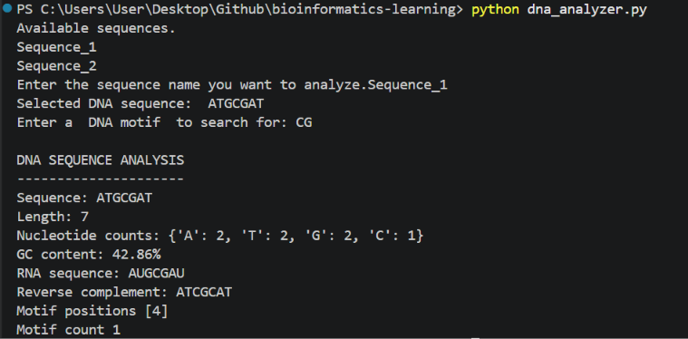
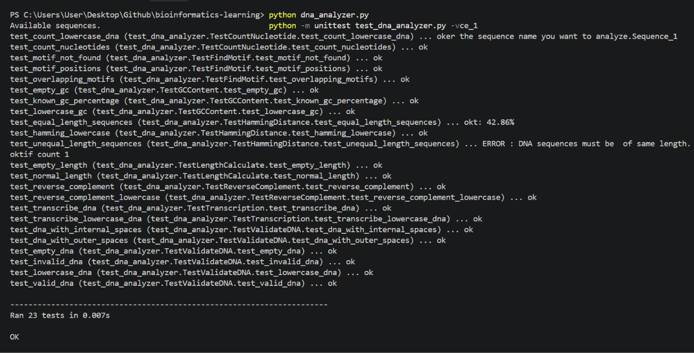

# 🧬 Bioinformatics Learning Journey

**Life Sciences Undergraduate | Aspiring Bioinformatician & Researcher**

I'm a Life Sciences undergraduate at the University of Delhi, developing programming and computational skills to explore biological questions.

This repository documents my hands-on learning in Python, bioinformatics, and computational biology, with an emphasis on writing, testing, and improving code.

## 🔬 Featured Project: DNA Sequence Analyzer

A Python-based tool for analyzing DNA sequences and practicing core bioinformatics operations.

### Features

- **DNA validation:** Checks whether sequences contain valid DNA bases.
- **Nucleotide counting:** Counts adenine (A), thymine (T), guanine (G), and cytosine (C).
- **Sequence length:** Calculates the number of nucleotides.
- **GC content:** Calculates the percentage of guanine and cytosine.
- **Transcription:** Converts a DNA sequence into an RNA sequence by replacing T with U.
- **Reverse complement:** Generates the reverse complement of a DNA sequence.
- **Motif search:** Finds motif positions, including overlapping occurrences.
- **FASTA support:** Reads multiple sequence records and lets the user select a sequence for analysis.
- **Hamming distance:** A separate utility function for counting differences between equal-length sequences.

## 🛠️ Technologies

- Python 3.12.12
- Python `unittest`
- Git and GitHub
- Visual Studio Code
- Rosalind bioinformatics exercises

## ▶️ Getting Started

### Requirements

- Python 3.12.12 or a compatible Python 3 version.
- The project files, including `dna_analyzer.py`, `read_fasta.py`, and `sample.fasta`.

### Run the analyzer

Open a terminal in the project directory and run:

```bash
python dna_analyzer.py
```

The program lists the available FASTA sequence records. Select a sequence by name, then enter a DNA motif to analyze it.

### Run the automated tests

Run:

```bash
python -m unittest test_dna_analyzer.py -v
```

**Current test result:** 23 tests passed.

The tests cover DNA validation, nucleotide counting, sequence length, GC content, transcription, reverse complement, motif search, and Hamming distance.

## 🧪 Example Analysis
 

## Run the automated tests
  
### Understanding the results

- The sequence contains 7 nucleotides.
- Three of the seven nucleotides are G or C, giving a GC content of 42.86%.
- The RNA sequence is produced by replacing thymine (T) with uracil (U).
- The reverse complement represents the complementary sequence in reverse order.
- The motif `CG` occurs once, beginning at position 4 using 1-based indexing.

## 🧬 Scientific Context

- **GC content:** Describes the proportion of G and C bases in a DNA sequence and can help characterize sequence composition.
- **Motif search:** Locates short sequence patterns that may be biologically relevant depending on their context.
- **Transcription:** Demonstrates a basic DNA-to-RNA sequence conversion.
- **Reverse complement:** Helps examine a DNA sequence in the opposite orientation.
- **Hamming distance:** Counts position-by-position differences between equal-length sequences and can support sequence comparisons.

These are basic computational tools for learning sequence analysis; their results alone do not establish a sequence's biological function.

## ⚠️ Input Limitations

- The analyzer accepts DNA sequences containing A, T, G, and C.
- Lowercase DNA input is normalized to uppercase.
- Empty sequences and invalid characters are rejected during validation.
- Ambiguous bases such as `N` are rejected by the current validation logic.
- Hamming distance is available as a separate function and requires sequences of equal length.
- The main interactive workflow analyzes one selected FASTA sequence at a time.

## 🧪 Hands-on Practice

- Python coding exercises and problem-solving.
- [Rosalind](https://rosalind.info/) bioinformatics challenges.
- DNA sequence problems and small computational biology projects.
- Git and GitHub for version control.

## 🎯 Career Goal

Build a strong foundation in bioinformatics, develop practical computational skills, and prepare for research and internship opportunities.

*Learning by coding, one biological question at a time. 🧬*
